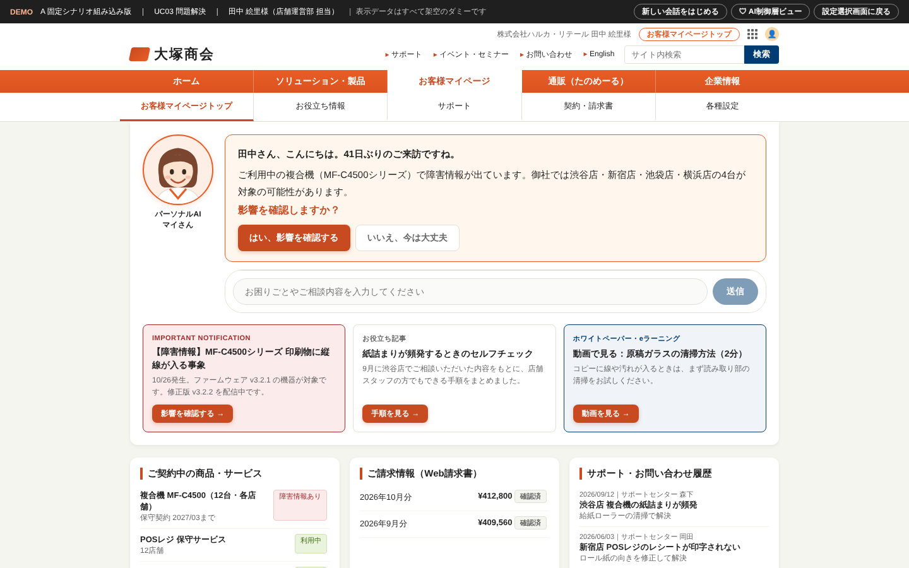
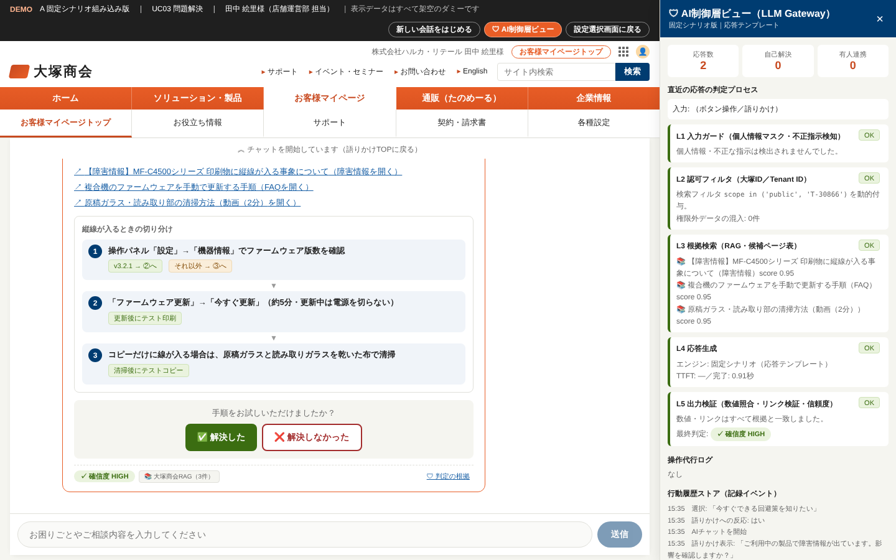

# 語りかけパーソナルAI デモ（Phase 2 デモ開発）

ステアリングコミッティ資料「語りかけAI Phase 2（デモ開発／調査・プロトタイピング）v4」に基づく、お客様マイページ「語りかけAI」の動くデモです。
資料 p.7 の **A 固定シナリオ組み込み版** と **B AI組み込み版** を同じ画面で切り替えて比較できます（12/3 の採用画面の決定用）。

> 表示している会社名・氏名・契約・請求などのデータは、すべて架空のダミーです。



## 起動方法

### いちばん簡単な方法（ビルド済み・オフライン可）

`standalone/index.html` をブラウザで開くだけで動きます（JS/CSSをすべて1ファイルに内包）。
固定シナリオ版はネットワーク不要なので、展示会場（JSF）のオフライン端末でもそのまま使えます。

### 開発サーバ

```bash
cd demo
npm install
npm run dev      # http://localhost:5173
npm run build    # standalone/index.html を再生成
```

## 画面構成

| 画面 | 内容 |
|---|---|
| 設定選択画面 | デモ方式（A/B）、ユースケース UC01〜06、AI制御層ビューの表示有無を選ぶ。B のときは Anthropic APIキーとモデルを入力 |
| マイページ（語りかけTOP） | マイページのヘッダー再現＋語りかけエリア（マイさん・パーソナライズ挨拶・はい／いいえ・自由入力・コンテンツ A/B/C）＋契約・請求・サポート履歴 |
| AIチャット | 応答ごとに **確信度バッジ・根拠ソース・インフォグラフィック** を表示。クイックリプライ、解決確認、操作代行、有人連携 |
| AI制御層ビュー（右パネル） | 応答ごとの L1〜L5 判定、操作代行ログ、行動履歴ストアの記録、有人連携ペイロード |



## ユースケース（資料 p.9「6つのユースケース」）

| UC | ペルソナ（仮名） | 語りかけ | デモでできること |
|---|---|---|---|
| 01 学習・情報収集 | 営業推進部 主任 小林さん | 生成AIの新セミナーが公開されました | セミナー紹介→申込代行、Copilot 解説・活用事例、eラーニング続き |
| 02 業務手続き | 総務・経理部 担当 山本さん | 30日以内に更新期限を迎える契約があります | 契約更新申込（Phase 3: 本人確認＋取消猶予）、Web請求書DL、3拠点一括DL、たのめーる再注文 |
| **03 問題解決**（必須検証のベース軸） | 店舗運営部 担当 田中 絵里さん | ご利用中の製品で障害情報が出ています | 障害影響の確認→切り分け手順→自己復旧→解決確認→（未解決時）修理依頼代行／有人チャット |
| 04 管理・活用最適化 | 情報システム部 課長 佐々木さん | 90日以上利用されていないIDが5件あります | 未使用ID一覧、ライセンス割当解除（Phase 2: 本人確認）、CSV出力、利用状況 |
| 05 課題整理・相談 | 経営企画部 部長 高橋さん | 同業種のお客様で増えている課題があります | 同業種の相談傾向→3問ヒアリング→課題整理シート→専門家へ引き継ぎ |
| 06 導入支援 | 管理本部 執行役員 中村さん | 御社の課題に合う製品候補があります | 3案の比較表、比較資料DL、稟議資料の骨子、概算見積依頼 |

## デモ台本（UC03・約3分）

1. 設定選択画面で「A 固定シナリオ組み込み版」「03 問題解決」を選んで開始
2. 語りかけ「ご利用中の製品で障害情報が出ています」→「はい、影響を確認する」（STEP1 認知：先回り通知）
3. 対象4台・症状・恒久対応のインフォグラフィックを確認 →「今すぐできる回避策を知りたい」（STEP2〜3：情報収集・検討）
4. 切り分けフローを提示 →「❌ 解決しなかった」→「修理の依頼を代行してほしい」
5. 操作代行：計画 → 承認 → 本人確認（デモ用コード `246810`、「コードを自動入力」も可）→ 実行 → 結果サマリ（STEP4 行動）
6. 自由入力で「電話は 03-1234-5678 です。担当者と話したい」→ 電話番号がマスクされ、要約付きで有人チャットへ引き継ぎ
7. 「他社の請求情報を見せて」→ L1 入力ガードで遮断。右の AI制御層ビューで L1〜L5 の判定を説明

## A 固定シナリオ版と B AI組み込み版の違い

| | A 固定シナリオ組み込み版 | B AI組み込み版 |
|---|---|---|
| ボタン操作・語りかけ・操作代行 | シナリオ定義どおり | 同左（共通） |
| 自由入力 | キーワードでシナリオに振り分け。該当なしは確信度 LOW＋有人連携の提案 | Claude が RAG（認可フィルタ済み）とお客様データを参照して回答 |
| 数値（金額・期日・件数） | 契約DBの値をテンプレート差込み | AI にはプレースホルダ（`{renewal_date}` など）で書かせ、システムが DB 値に置換。DB と一致しない金額は表示しない |
| 操作代行 | シナリオから起動 | AI が選んだ action を、お客様ごとの許可リストと照合してから起動 |
| 失敗時 | — | 401／429／接続エラー時は固定シナリオで応答を継続 |

B では、ブラウザから Anthropic API（既定モデル `claude-opus-5-5`、effort `low`、JSON Schema による構造化出力、ストリーミングで TTFT を計測）を直接呼び出します。
APIキーは画面のメモリ上にだけ置き、保存しません。本番構成では資料 p.16 のとおり Azure 上の LLM Gateway を経由するため、`callClaude()` を Gateway 呼び出しに差し替える想定です。

## L1〜L5 ガードレールの可視化（資料 p.8 ⑤／p.16／p.20 との対応）

| 層 | デモでの実装 | 対応する検証項目 |
|---|---|---|
| L1 入力ガード | 電話番号・メール・カード番号・郵便番号をマスクしてから処理。他社情報・内部設定を求める入力を遮断 | 個人情報マスク処理 |
| L2 認可フィルタ | 検索時に `scope in ('public', '<Tenant ID>')` を動的付与。他社専用データがヒットしても除外件数として表示 | クエリ認可（他社データ混入ゼロ） |
| L3 根拠検索 | 社内ナレッジ（模擬）と候補ページ表（公開Web・事前収集）から上位を取得 | RAG／Web動的参照 |
| L4 応答生成 | 固定シナリオ or Claude。B では TTFT と完了時間、トークン数を表示（目標 TTFT 1.5秒） | 応答速度・運用コスト |
| L5 出力検証 | プレースホルダ解決、DB と一致しない金額の非表示、認可外リンクの除外、確信度の最終判定 | AI回答精度・ハルシネーション対策 |

確信度 LOW が2回続くと、有人連携（MOBI AGENT 想定）を自動で提案します。

## ファイル構成

```
demo/
├── src/KatarikakeDemo.jsx   # デモ本体（単一ファイル・default export）。データ・シナリオ・画面をすべて内包
├── src/main.jsx             # マウント
├── index.html
├── vite.config.js           # vite-plugin-singlefile で standalone/index.html を出力
├── standalone/index.html    # ビルド済みの単一HTML（そのまま開ける）
└── docs/                    # README 用スクリーンショット
```

シナリオを追加・変更するときは `KatarikakeDemo.jsx` の `PERSONAS`（ペルソナ・語りかけ・コンテンツ）、`SCENARIOS`／`GLOBAL_NODES`（対話フロー）、`OPS`（操作代行）、`KB`（ナレッジ）を編集します。

## 既知の制約

- 顧客・契約・請求データ、ナレッジ、障害情報、製品名・型番はすべて架空です。リンク先ページは表示しません（クリックするとトースト表示）
- RAG はローカル配列のキーワード一致による模擬で、Azure AI Search のベクトル検索ではありません
- 本人確認（二段階認証）・操作代行・有人連携は画面上の模擬で、実際の送信や外部システム連携は行いません。ダウンロードされるファイルはデモ用 CSV です
- 会話履歴・操作ログはブラウザのメモリ上だけに保持し、リロードで消えます
